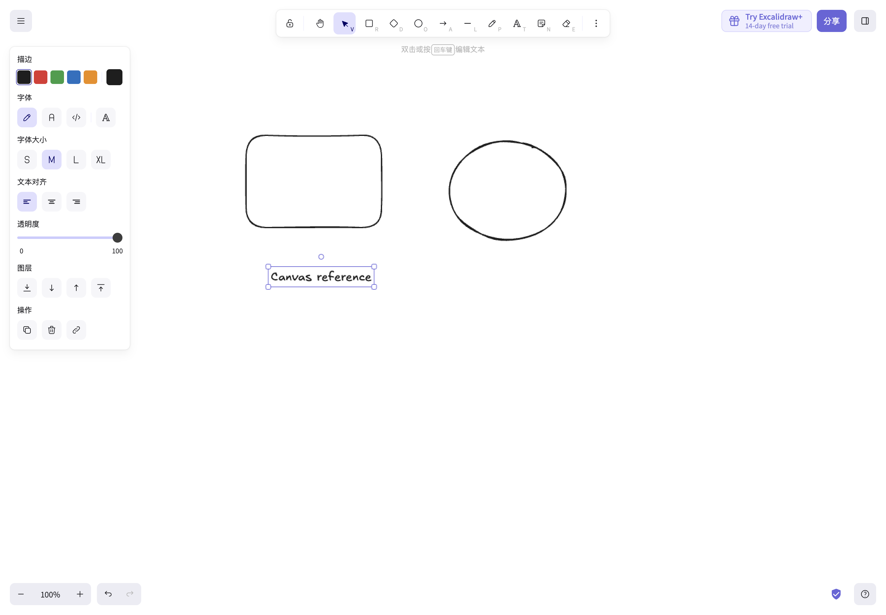
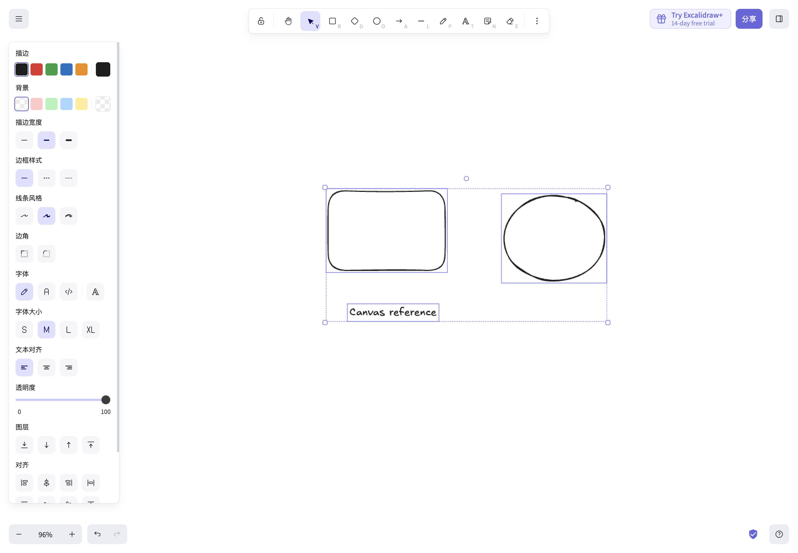
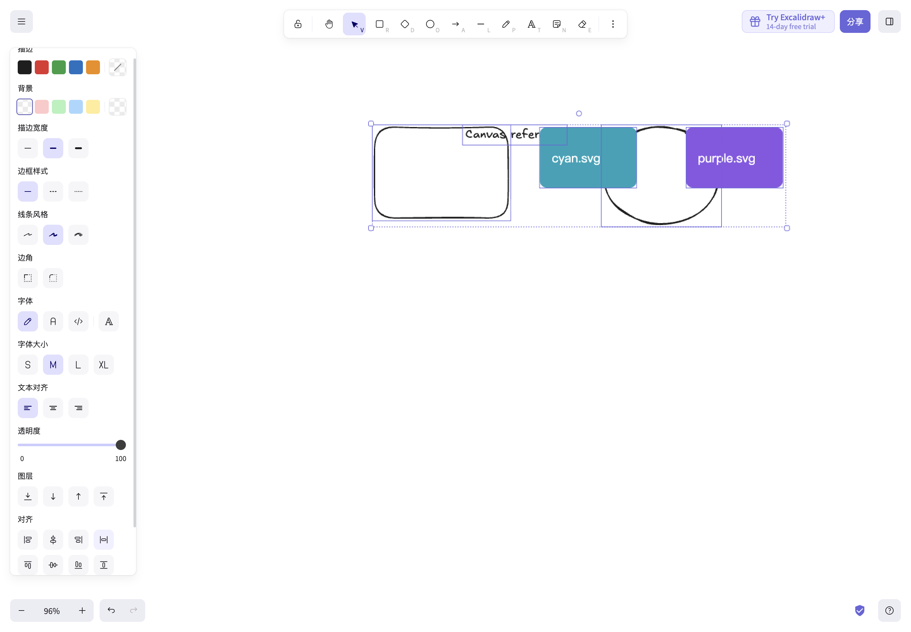

# Excalidraw REA 实测研究：Astro Studio 画布升级

研究时间：2026-10-27，09:28–09:33（Asia/Shanghai）。目标：参考成熟画布的交互和状态边界，继续使用 Astro Studio 的 Konva 引擎，服务「导入图片 → 排版标注 → 生成区域 → 结果回画布」流程。

## 方法与可复核环境

**实际运行了 REA CLI，没有把普通页面阅读称为 REA。** 独立 Chrome 使用 `/tmp/astro-rea-chrome` 用户目录和 CDP `http://127.0.0.1:9333`，访问 `https://excalidraw.com/`。REA 被动记录 V8 执行覆盖；单独的 Playwright Core/CDP 驱动键盘、指针和图片 drop。每组记录16秒，并在记录窗口内操作。最终四组 CLI 使用临时安装的 **REA 6.8.0 / Node v24.22.1**，Chrome **155.0.8059.85**，视口1440×1000 CSS px。项目依赖、全局 agent 设置和默认运行时未修改。

`rea-version.txt`、`node-version.txt`、`browser-targets.json` 保存版本/目标；`steps.json` 保存最终调用、独立 Node 绝对路径和操作序列；`collect.cjs` 保存可重放的操作实现。首次 discovery/inspection 使用主机 Node24.15，最终四组 execution/screenshot 全部使用隔离 Node24.22.1。脚本重放前需替换 target ID，清空独立浏览器的 `excalidraw`/`excalidraw-state` 后 reload；不要对个人浏览器运行清理。

| 操作组 | 最终 REA 窗口 UTC | 实测步骤和状态 | 证据 |
|---|---|---|---|
| 形状/文本 | 01:31:16–01:31:32 | R拖矩形；O拖椭圆；T点击、输入、Escape。矩形(400,220,220,150)；椭圆(730,230,190,160)；文字20px、lineHeight1.25，点击y450后顶部y437.5。创建后回选择工具。 | `01-shapes-text-execution.json` / `01-shapes-text-state.json` / `01-shapes-text.png` |
| 平移/缩放 | 01:31:32–01:31:48 | Space+拖动空白(+90,+50)；指针(800,400)处Meta+wheel(-180)，反向(+180)。对象世界几何不变；最终zoom=.958607，scroll=(124.544292,67.272146)。 | `02-pan-zoom-execution.json` / `02-pan-zoom-state.json` / `02-zoomed.png` / `02-pan-zoom.png` |
| 多选/拖动 | 01:31:49–01:32:05 | V框选三对象，再拖矩形中心(+90,+70)px。三对象都进入selectedElementIds；三对象世界位移均(+93.886233,+73.022626)，等于屏幕位移/zoom，尺寸及相对间距保持。 | `03-multiselect-drag-execution.json` / `03-multiselect-drag-state.json` / `03-selected.png` / `03-multiselect-drag.png` |
| 导入/布局 | 01:32:05–01:32:21 | DataTransfer drop两个本地生成SVG；全选；点击顶部对齐、水平等距分布；撤销再重做。两图均160×100、独立fileId，初始同y，间隔52.159018世界单位=50屏幕px。布局后五对象y均143.522945；分布保持两端边界。 | `04-image-layout-execution.json` / `04-before-layout-state.json` / `04-after-layout-state.json` / `04-image-layout-state.json` / `04-image-layout.png` |

四组 execution 的 `coverage.state` 均为 `captured`，执行过的函数记录数分别1440、942、1265、1350（仅统计各函数至少一个range count>0，**不加总重叠range的count**）。完整 evidence_id、窗口、脚本URL在 `execution-summary.json`。每个 `*-execution.stderr.txt` 保留 REA armed/ended 进度消息。`*.json` 保留原始 CLI JSON，包括完整归一化来源/覆盖与限制；截图JSON还包含原始PNG base64及REA计算的sha256。独立PNG是从该base64原样解码，未重绘。`SHA256SUMS.txt` 可校验文件。

## 固定源码交叉验证

GitHub 仓库 https://github.com/excalidraw/excalidraw ，固定commit **b7de45e88111f5680ae4bb3c3f3541c7d3b279fe**（git ls-remote取得）。`source/PROVENANCE.md` 说明下载方式和边界，`source/SHA256SUMS.txt` 保存来源文件哈希。完整tar下载超时，在截断前已完整解出的成员用于交叉验证；wheel/snapping另外直接从固定commit的raw GitHub获取。

1. [App.wheel.ts:75–107](https://github.com/excalidraw/excalidraw/blob/b7de45e88111f5680ae4bb3c3f3541c7d3b279fe/packages/excalidraw/components/App.wheel.ts#L75-L107)：Meta/Ctrl缩放；Shift水平平移；Meta/Ctrl+Shift垂直平移；平移除以zoom。123–170的zoomBy截断delta并以当前指针锚定视口。当前源码还包含auto输入设备识别和中键wheel等规则，Astro不必照搬所有手势。
2. [snapping.ts:41–49](https://github.com/excalidraw/excalidraw/blob/b7de45e88111f5680ae4bb3c3f3541c7d3b279fe/packages/excalidraw/snapping.ts#L41-L49)：SNAP_DISTANCE=8，返回8/zoom，保持视觉吸附距离稳定。**本轮未操作开启吸附；这条是源码证据，不是运行时吸附验证。**
3. [App.tsx:10704–10765](https://github.com/excalidraw/excalidraw/blob/b7de45e88111f5680ae4bb3c3f3541c7d3b279fe/packages/excalidraw/components/App.tsx#L10704-L10765)：批量图片先放placeholder，再异步初始化，成功后按50/zoom间距重新排列、选中，并IMMEDIATELY提交更新。与两图实际50屏幕px间距吻合。
4. [actionAlign.tsx:39–96](https://github.com/excalidraw/excalidraw/blob/b7de45e88111f5680ae4bb3c3f3541c7d3b279fe/packages/excalidraw/actions/actionAlign.tsx#L39-L96)：对齐要求多组选择，排除frame-like对象；顶部对齐axis=y/start，一次历史提交。Astro生成框是否参与普通布局需由业务约束决定。
5. [distribute.ts:25–109](https://github.com/excalidraw/excalidraw/blob/b7de45e88111f5680ae4bb3c3f3541c7d3b279fe/packages/element/src/distribute.ts#L25-L109)：先按组边界计算等间距，空间不足时改用中心分布并保持端点。这解释本轮宽度总和超过整体包围框时观察到的重叠，不应把该结果误记为正间距排版。

## 对 Astro Studio 的实现结论

- 视口只改变世界→屏幕转换，不写入节点几何；指针锚定缩放，Space和手型临时拥有平移。输入框编辑时应避开全局工具快捷键。用最终状态提交历史，避免每次mousemove占一个undo。
- 多选操作使用同一组起始快照和同一world delta；框选、Shift增减选、共同变换框和工具反馈保持一致。几何只在拖动完成后持久化。屏幕阈值转world时统一除zoom。
- 矩形、椭圆、文本应进入同一个节点模型、渲染、边界、复制、导出、撤销路径。形状预览放在交互层；文本使用可聚焦编辑覆盖层并明确Enter/Escape/blur提交边界。不要把文本光标输入当成画布命令。
- 吸附作为明确的产品开关；针对选区包围框的边缘/中心计算候选，屏幕距离约6–8px；最终被吸附的位置与导线必须共享一个计算结果。此项来自固定源码设计参考，仍需Astro自身测试。
- 图片批量导入一次进入统一布局，并保留纵横比和文件引用；布局后的历史应是一个可撤销操作。普通等距分布应明确空间不足规则，可优先采用不重叠网格排版以服务AI结果比较。
- 生成区域与结果是Astro的业务扩展，不能声称从Excalidraw得到实现证据：统一world几何、明确关联frameId、生成时保留空位/进度、结果回填保留大小及排版、失败不破坏已有结果，并在调用生成API前固定本次裁切/输入快照。

## 证据边界

REA覆盖证明该16秒窗口记录了网站主文档脚本执行，**不是逐手势调用因果追踪，也不是性能基准**。REA会重置覆盖计数并临时影响优化；部分函数仅有函数级覆盖；worker/iframe/WASM不在覆盖范围内。`collect.cjs` 的操作与截图/存储状态补充了用户层结果证据。localStorage读出是外部Playwright验证，不是REA内置状态解释。

live excalidraw.com 的发布commit没有被证明等于固定GitHub commit；本报告仅交叉验证同类可见行为和源码结构，不声称源码地址映射到某条minified运行时函数。未测触控、多指macOS原生手势、实际磁盘文件选择器、协作、长文排版、所有resize/rotate变体或复杂组合吸附。图片drop由浏览器DataTransfer构造真实File后触发，而非操作系统Finder拖拽。生成区域与API流程是Astro的后续产品实现。

仓库当前 `.gitignore:47` 忽略所有docs目录；如需随代码保留本研究，请显式 `git add -f docs/research/canvas-rea`。镜像截图也存在 `output/playwright/canvas-rea`，该目录同样可能被忽略。

## Astro Studio 实施与最终验收

已保留 Konva 内核，完成形状/文字、平移缩放、吸附/排版、生成框编辑及生成结果回填。文档 v2 保留 v1 读取兼容，新增对象和请求关联经过 Rust 往返验证。

- [原始 REA 证据压缩归档](rea-evidence.tar.gz)：无损收录前述原始 JSON、版本、步骤、脚本、校验与固定源码材料；同名解压文件也保留在此目录。
- [浏览器验收记录](astro-browser-verification.json)：真实 Chrome 操作，中文多行文字、绘图、平移缩放、复制/撤销、自动保存/重新加载通过，无页面错误。
- [桌面真实生成验收记录](astro-native-verification.json)：使用现有 gpt-image-2 提供商发起一次真实图片编辑请求。结果成功，原构图保留，512宽生成框右侧x=544插入一张512×512结果，即32世界单位间距，完成关联与图片一起保存。
- [升级前截图](astro-before.png)、[升级后浏览器截图](astro-after.png)、[桌面生成完成截图](astro-desktop-after.png)。

真实桌面验收补获两处仅靠模拟测试难以发现的问题并已修正：画布导出图需要登记到既有图片来源注册表；Tauri本地asset图片需在设置src前声明anonymous CORS，否则WebKit会污染canvas并禁止PNG导出。验收临时入口和开发代理已移除，未改变正式入口或开发配置。

数据恢复验证包括跨页面挂载的读写顺序、失败保存的原样重试、提交响应丢失后的精确请求查询、重复事件去重、跨文档迟到结果隔离。撤销内容编辑保留当前视口和请求完成标记，避免重复回填。文本按真实字形宽度测量，并在字号变化时同步更新边界。

限制：Windows桌面未在本机实测；触控板物理捏合和中文输入法候选窗口未人工验收，已有对应事件/组合输入回归覆盖。REA线上部署与固定源码提交的一致性边界见上文。

最终检查：`npm test` 65个文件、427项测试通过；`cargo test --manifest-path src-tauri/Cargo.toml` 359项测试通过；`npm run build`通过；`git diff --check`通过。研究原始数据使用独立Node24.22.1/REA6.8.0，项目依赖与默认运行时未变。
